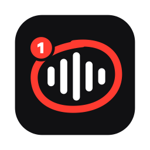

<p align="center"></p>

<h1 align="center">Scribble</h1>

<p align="center">
  <b>Talk and draw on your screen, paste the result into any coding agent.</b><br>
  An app for macOS, Windows and Linux that turns "this thing here is broken" into annotated
  screenshots and a transcript that says exactly which mark you meant, and when. On-device,
  no API keys.
</p>

<p align="center"><sub>Scribble used to be called voice-annotate. Until the next release the app, its
command, its <code>~/.voice-annotate</code> folder and the download files keep that name.</sub></p>

<p align="center">
  <a href="https://github.com/andropar/voice-annotate/releases/latest/download/voice-annotate-macos.zip"><b>Download for macOS</b></a> ·
  <a href="https://github.com/andropar/voice-annotate/releases/latest/download/voice-annotate-windows-setup.exe"><b>Windows installer</b></a> ·
  <a href="#windows-and-linux"><b>Linux</b></a> ·
  <a href="https://jroth.space/voice-annotate/">Website</a>
</p>


## Why

Explaining a UI problem to an agent in text takes longer than fixing it, and a bare
screenshot loses the pointing: *this* number, *that* legend, move *this* button *there*.
Scribble records what you say while you draw. Every mark is numbered and burned into
the image. The transcript then cites the mark at the word you were saying when you drew it,
with its location in image pixels:

> This best `[#1 circled (301,290)-(450,340) in frame 1]` accuracy says 312%. That has to be
> a units bug…

The agent gets both what you meant and where it is, and can act on it without a back-and-forth.
The figure above is real output: the screen is a mockup, the voice is macOS text-to-speech, and
everything else is the actual pipeline ([example capture.md](docs/demo/example-capture.md)).

## Features

- **Snapshot** (`⌃⌥⌘S`) freezes every display. You draw and talk over the frozen screen. You
  can hide the overlay, navigate somewhere else and take the next shot without stopping the
  recording.
- **Walkthrough** (`⌃⌥⌘R`) records the screen while you keep working. Hold `⌃⌥` to draw
  laser-pointer marks that fade away. Agents can't watch video, so the recording becomes an
  adaptive keyframe storyboard (up to 30 frames), picked from screen changes, clicks, speech
  and annotations.
- **Dictation** (`⌃⌥⌘T`) records only your voice and copies the plain transcript, for
  prompts you'd rather say than type.
- **Point or draw.** The arrow, box, ellipse, highlighter and pin tools make numbered
  marks for pointing at things. The pen is for drawing (a layout idea, a word, a sketch):
  its strokes stay exactly as drawn and get no badges. Strokes drawn in one go become a
  single `[drawing (n strokes) over …]` reference at the moment you started.
- **Grounded references.** Each mark appears in the transcript as `[#n <shape> <coords> in
  frame k]`, aligned to word-level timestamps.
- **Multi-display.** All displays are captured in parallel. In walkthroughs, the cursor
  position decides which display a keyframe comes from.
- **Detail crops.** On 4K/6K displays, annotated regions also get a native-resolution crop,
  so small text stays readable after downscaling.
- **Light on the chat.** By default the clipboard gets the transcript plus `capture.md`, not
  the images. Agents that can read files (Claude Code in the terminal or desktop app) open
  the frame paths listed in it when they need them. For web chats, *Recent captures* →
  *capture.md + images* attaches the frames too.
- **Your language.** Narrate in any of the 100 languages Whisper supports, or let it
  auto-detect: pick one in Settings → Transcription. English is the default. Add the English
  labels you mention to the custom vocabulary so they keep their spelling.
- **Fully local.** Transcription runs with [WhisperKit](https://github.com/argmaxinc/WhisperKit)
  (Whisper large-v3 turbo by default) on the GPU or Neural Engine. Nothing leaves the machine.

The shortcuts and details above are those of the macOS app. The
[Windows and Linux](#windows-and-linux) version has the same three modes and writes the same
bundle, with its own shortcuts and a different transcription engine.

## How it works


Some of the design decisions:

- **One clock.** Strokes, clicks, audio samples, SCStream frames and `NSEvent`s are all
  stamped in host time (`mach_absolute_time`). That's what lets a stroke land on the word
  you were saying when you drew it.
- **Storyboard instead of video.** During recording, each frame is shrunk to a 64×40
  luminance thumbnail and diffed against the previous one. Keyframe candidates are frames
  where the screen settles after a change, clicks, the end of an annotation burst, speech
  onsets and a periodic fallback. They are scored and spaced at least 1.2 s apart.
  Annotated frames are always kept, and near-duplicates are dropped.
  [SPEC.md §4](SPEC.md#4-walkthrough--keyframe-storyboard) has the details.
- **Pasteboard pragmatics.** Different apps read a mixed pasteboard differently. Terminals
  take the text, and Electron chats take the files and silently drop the text. So the
  clipboard item carries both the transcript text and a file URL to `capture.md`.
- **Responsive while capturing.** The overlay is a nonactivating `NSPanel` that takes key
  focus without activating the app. The model is preloaded at launch. Auto compute starts on
  a GPU build (about 0.25× real time) while the Neural Engine build (about 0.08×) compiles
  in the background.
- **Testable core.** Shape classification, keyframe selection, transcript interleaving,
  markdown composition and coordinate mapping live in `VoiceAnnotateCore`, a pure Swift
  module with unit tests. The app target holds only the AppKit, ScreenCaptureKit and
  WhisperKit glue.

The full design is in [SPEC.md](SPEC.md).

## Install

For Windows and Linux see [below](#windows-and-linux). The macOS app requires macOS 15 or
later on Apple Silicon.

1. Download
   [voice-annotate-macos.zip](https://github.com/andropar/voice-annotate/releases/latest/download/voice-annotate-macos.zip),
   unzip it and move `voice-annotate.app` to Applications.
2. The app isn't notarized (that needs a paid Apple Developer ID), so macOS blocks the first
   launch. Open it once, click **Done**, then go to System Settings → Privacy & Security and
   click **Open Anyway** next to the voice-annotate message. Alternatively, in Terminal:
   `xattr -dr com.apple.quarantine /Applications/voice-annotate.app`.

Or build it yourself (see [Build](#build)).

### First run

- **Permissions.** Grant **Screen Recording** when asked, then quit and reopen the app (macOS
  only applies it after a relaunch), and allow the **Microphone**. Until Screen Recording is
  granted, the menu bar menu shows a warning that opens the setup window.
- **Model download.** The Whisper model (~630 MB) downloads once to
  `~/.voice-annotate/models`; the menu bar menu shows progress (and a retry if it fails). A
  capture finished before the download is done waits for it, with the progress on screen.
  Settings also offer lighter multilingual models, Small (~490 MB) and Base (~150 MB), which
  are less accurate outside English, and English-only ones, which warn if you pick another
  language.
- **Faster after a while.** For about 10 minutes after the first start, macOS compiles the
  model for the Neural Engine in the background. Until then transcription runs on the GPU,
  roughly 3× slower (a 1-minute recording takes ~15 s instead of ~5 s).
- **After updating** to a new release (or rebuilding with ad-hoc signing, or replacing the app
  with a differently signed build), macOS may keep showing Screen Recording as enabled while
  the app still can't record: the grant belongs to the old build, and switching it off and on
  doesn't help. Remove voice-annotate from the list in System Settings → Privacy & Security →
  Screen Recording (the − button), then add it again, or run
  `tccutil reset ScreenCapture com.jroth.voiceannotate`, reopen the app and grant it again.

## Use

| Shortcut | |
|---|---|
| `⌃⌥⌘S` | **Snapshot.** Freezes all displays; draw and talk. `⇥` hides the overlay so you can navigate, `⌃⌥⌘S` takes the next shot, `↩` finishes, `⎋` cancels |
| `⌃⌥⌘R` | **Walkthrough.** Records all displays while you work. Hold `⌃⌥` (or toggle with `⌃⌥⌘D`) to draw; `⌃⌥⌘R` again finishes |
| `⌃⌥⌘T` | **Dictation.** Voice only; `⌃⌥⌘T` again copies the transcript as plain text |
| `⌃⌥⌘F` | Finish any capture |

Snapshot tool keys: `P` pen · `A` arrow · `R` box · `O` ellipse · `H` highlighter ·
`N` pin · `1–6` colors · `⌘Z` undo.

Each capture is saved as a bundle in `~/.voice-annotate/captures/<timestamp>/`, containing
`capture.md`, the annotated frames, the audio, the recording and an `events.json` timeline.
Bundles are pruned after 14 days.

## Windows and Linux

A separate implementation in [`python/`](python) (Python and Qt) with the same flows and the
same bundle: `capture.md` is composed by a line-by-line port of the macOS app's core, and a
test checks that both produce the same file from the same capture.

### Install

**Windows** (10 or 11, 64-bit): download and run
[voice-annotate-windows-setup.exe](https://github.com/andropar/voice-annotate/releases/latest/download/voice-annotate-windows-setup.exe).
It installs for your user without administrator rights and can start the app at login. The
installer is not code-signed, so SmartScreen asks once: **More info** → **Run anyway**.

**Linux** (x86_64, glibc 2.35 or newer, i.e. Ubuntu 22.04 and later):

```bash
curl -fsSL https://raw.githubusercontent.com/andropar/voice-annotate/master/python/packaging/install-linux.sh | sh
```

This puts the app in `~/.local/opt/voice-annotate` with a menu entry and a `voice-annotate`
command in `~/.local/bin`; nothing needs root. Run the script again to update, or with
`sh -s -- --uninstall` to remove it. The same files are in
[voice-annotate-linux-x86_64.tar.gz](https://github.com/andropar/voice-annotate/releases/latest/download/voice-annotate-linux-x86_64.tar.gz)
if you would rather unpack it yourself and run `./install.sh`.

Both downloads are self-contained (no Python needed) and are built and tried out by
[GitHub Actions](.github/workflows/desktop.yml) from this source. The app puts an icon in
the system tray; *Settings* has *Launch at login*. On the first start it downloads a Whisper
model to `~/.voice-annotate/models` (Small English, ~480 MB, when it runs on the CPU).

With Python 3.9 or later you can also install it as a package, with
[uv](https://docs.astral.sh/uv/) or `pipx`:

```bash
uv tool install "git+https://github.com/andropar/voice-annotate#subdirectory=python"
```

On Linux that route needs two system libraries (`sudo apt install libportaudio2
libxcb-cursor0`). Start it with `voice-annotate` (on Windows, `voice-annotate-gui` starts it
without a console window).

### Use

| Shortcut | |
|---|---|
| `Ctrl+Alt+Shift+S` | **Snapshot.** `Tab` hides the overlay so you can navigate, the shortcut again takes the next shot, `Enter` finishes, `Esc` cancels |
| `Ctrl+Alt+Shift+W` | **Walkthrough.** Hold `Ctrl+Alt` (or toggle with `Ctrl+Alt+Shift+D`) to draw; the shortcut again finishes |
| `Ctrl+Alt+Shift+T` | **Dictation.** The shortcut again copies the transcript as plain text |
| `Ctrl+Alt+Shift+F` | Finish any capture |

Tool keys in a Snapshot are the same as on macOS, with `Ctrl+Z` for undo. All shortcuts can
be changed in Settings; one that another program already holds is flagged there and in the
tray menu.

Every action is also a command for the running app: `voice-annotate snapshot`,
`walkthrough`, `dictation`, `finish`, `toggle-draw`, `cancel`. Bind those in your desktop's
keyboard settings if you prefer, or have to (see Wayland below).

### What is different

- **Transcription** uses [faster-whisper](https://github.com/SYSTRAN/faster-whisper). With an
  NVIDIA GPU, CUDA 12 and cuDNN 9 (`pip install nvidia-cublas-cu12 nvidia-cudnn-cu12` into
  the same environment) it picks Large v3 Turbo; otherwise it runs on the CPU.
- **Clipboard.** Windows and X11 have one clipboard item with several formats, so a capture
  goes out as text plus a file list. Terminals paste the text, chat apps attach the files.
- **Linux, X11.** The capture toolbar cannot be hidden from screen recording there, so it
  shows up at the top of walkthrough keyframes; `capture.md` tells the agent what it is.
  GNOME shows the tray icon only with the AppIndicator extension (Ubuntu ships it); without
  a tray the app opens a small window with buttons instead.
- **Linux, Wayland.** Wayland keeps apps from watching the keyboard, the pointer or the
  screen. The app runs through XWayland in a reduced mode: Snapshot and Dictation work,
  started from the tray or from desktop shortcuts bound to the commands above. Walkthrough
  and hold-to-draw need an X11 session ("GNOME on Xorg", "Plasma (X11)"). This mode is
  written but has not been run on a real Wayland desktop yet.

### Status

The automated tests drive the real app with synthetic mouse and keyboard input on Windows
Server 2022 and 2025 and on Ubuntu under Xvfb (with and without a compositor, and at 150%
display scaling), and run a real Whisper model. Several displays are tested on an emulated
layout only. Not covered at all, so less certain: display scaling on Windows, the Wayland
mode, and transcription on a GPU.

## Build

The macOS app requires macOS 15+ on Apple Silicon and Xcode 16+ (Swift 6 toolchain).

```bash
make install   # build release, sign with your Apple Development identity, copy to ~/Applications
make run       # install + launch
make test      # unit tests (VoiceAnnotateCore)
make release   # ad-hoc signed zip for GitHub Releases, in build/
```

Without an Apple Development identity the build is signed ad-hoc, so each rebuild looks
like a new app to macOS: see *After updating* above for re-granting Screen Recording.

The binary also has developer commands, e.g. `.build/debug/VoiceAnnotate --help`:
`--transcribe <audio>`, `--render-demo <out.png>`, `--demo-snapshot <audio> [screenshot annotations]`,
`--test-screenshot [screen]`, `--test-walkthrough <seconds> [screen|all]`. They use the app's
settings; `--language <code|auto>`, `--model <variant>` and `--vocabulary <text>` override
them for one run.
`docs/demo/render.sh` regenerates the README images with the real pipeline.

The Windows/Linux app (see [python/README.md](python/README.md)):

```bash
cd python
pip install -e ".[dev]"
python -m voice_annotate      # run from source
pytest                        # core, pipeline and the capture state machine, headless
```

## Stack

macOS: Swift 6 · SwiftUI + AppKit · ScreenCaptureKit · AVFoundation · Core Graphics ·
WhisperKit (Core ML) · SwiftPM

Windows and Linux: Python · Qt 6 (PySide6) · mss · PyAV (FFmpeg) · PortAudio ·
faster-whisper (CTranslate2) · Win32 and Xlib for hotkeys and input

## License

[MIT](LICENSE)
